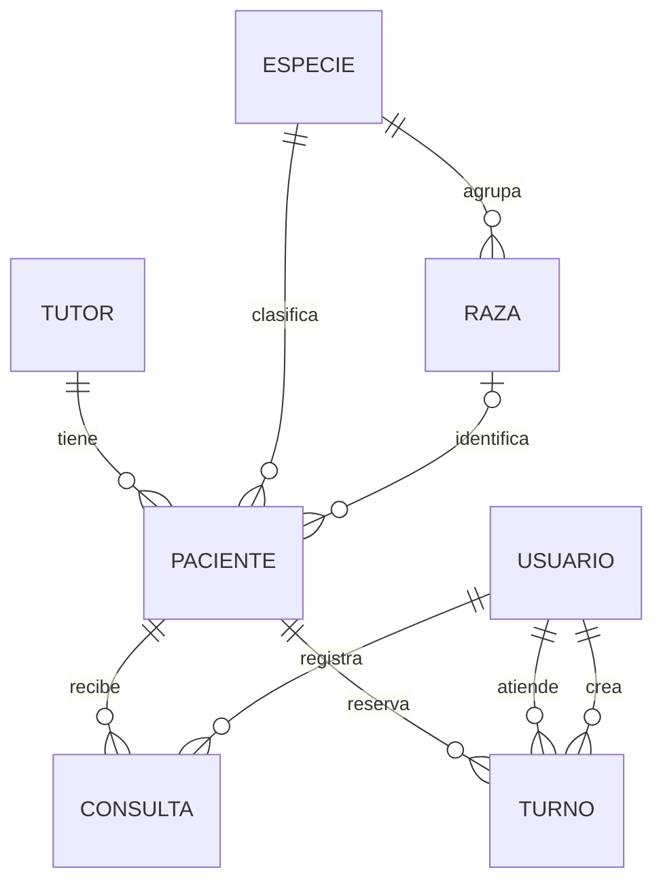
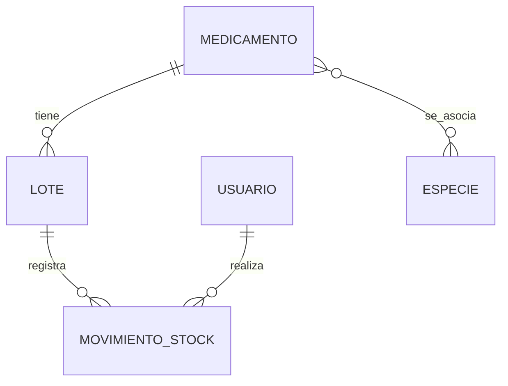
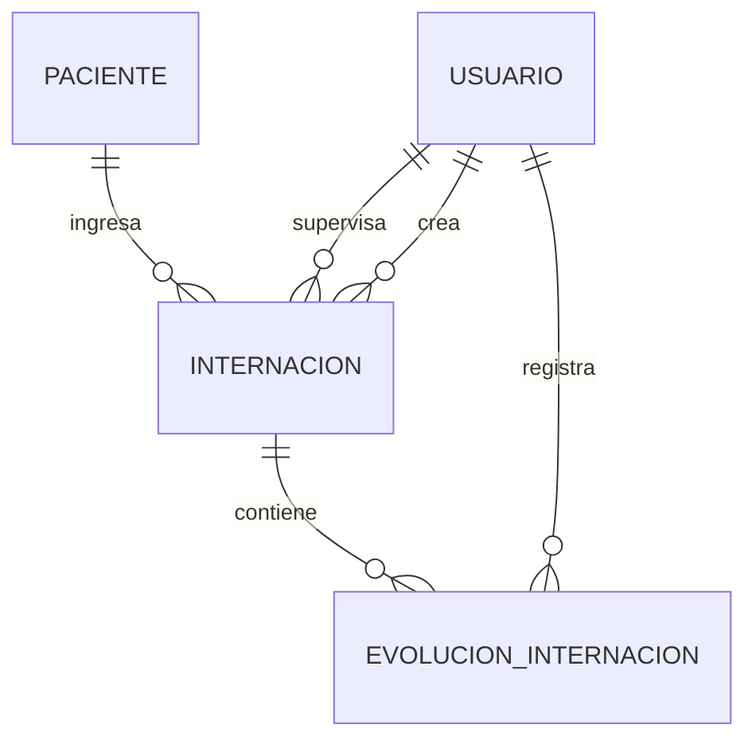

# CRM Veterinario Backend

API REST para gestionar tutores, pacientes, consultas clínicas, turnos, medicamentos, existencias e internaciones de una veterinaria.

Proyecto integrador de **Ingeniería de Software**, conectado con el frontend de **Programación III** desarrollado en Next.js con TypeScript. Las reglas de negocio y los permisos se validan en Django y los datos se almacenan en PostgreSQL.

> Antes de entregar: reemplazar el nombre genérico por la identidad definitiva de la veterinaria y completar integrantes, enlaces y capturas de la sección de entrega.

<a id="indice"></a>

## Índice

- [Repositorios](#repositorios)
- [Tecnologías](#tecnologias)
- [Módulos](#modulos)
- [Modelo de datos y relaciones](#modelo-de-datos-y-relaciones)
- [Reglas de negocio](#reglas-de-negocio)
- [Roles y autenticación](#roles-y-autenticacion)
- [Ejecución local con Docker](#ejecucion-local-con-docker)
- [Recursos de la API](#recursos-de-la-api)
- [Documentación OpenAPI](#documentacion-openapi)
- [Comprobaciones y mantenimiento](#comprobaciones-y-mantenimiento)
- [Respaldo de PostgreSQL](#respaldo-de-postgresql)
- [Entrega y despliegue](#entrega-y-despliegue)
- [Mejoras futuras](#mejoras-futuras)

[↑ Volver al índice](#indice)

<a id="repositorios"></a>

## Repositorios

- Backend: https://github.com/MAngeloni-dev/backend
- Frontend: https://github.com/MAngeloni-dev/frontend
- Tablero Kanban: **pendiente de agregar el enlace de Trello**.
- API desplegada: **pendiente de agregar la URL pública**.
- Frontend desplegado: **pendiente de agregar la URL pública**.

[↑ Volver al índice](#indice)

<a id="tecnologias"></a>

## Tecnologías

| Herramienta | Uso |
| --- | --- |
| Python y Django | Modelos, ORM, validaciones, vistas y administración. |
| Django REST Framework | Serializers, ViewSets, autenticación y permisos de API. |
| PostgreSQL 17 | Datos relacionales y restricciones de integridad. |
| SimpleJWT | Tokens de acceso y renovación. |
| django-filter | Filtros sobre los recursos. |
| django-cors-headers | Orígenes autorizados para solicitudes desde el navegador. |
| drf-spectacular | Generación de OpenAPI y visualización con Swagger UI y ReDoc. |
| uv | Dependencias y entorno de Python; versiones resueltas en `uv.lock`. |
| Docker Compose | Ejecución coordinada de backend, base de datos y frontend. |

Las versiones declaradas y resueltas se consultan en `pyproject.toml` y `uv.lock`.

[↑ Volver al índice](#indice)

<a id="modulos"></a>

## Módulos

| App | Responsabilidad |
| --- | --- |
| `usuarios` | Cuenta personalizada, roles e identidad del usuario autenticado. |
| `pacientes` | Tutores, especies, razas y pacientes. |
| `clinica` | Consultas y registro de atención clínica. |
| `turnos` | Reservas, confirmación, cancelación y atención. |
| `inventario` | Medicamentos, lotes, movimientos y alertas. |
| `internaciones` | Ingresos, evoluciones y egresos. |
| `config` | Configuración, URLs generales y router central. |

[↑ Volver al índice](#indice)

<a id="modelo-de-datos-y-relaciones"></a>

## Modelo de datos y relaciones

El sistema contiene **12 modelos propios**: Usuario, Tutor, Especie, Raza, Paciente, Consulta, Turno, Medicamento, Lote, MovimientoStock, Internacion y EvolucionInternacion. La tabla intermedia automática de la relación medicamento-especies no se incluye en ese conteo.

La documentación de campos, cardinalidades, restricciones y decisiones está en [Modelo de datos](docs/modelo_datos.md).

### Atención de pacientes



### Inventario



### Internaciones



Los diagramas representan el modelo desarrollado y sus ampliaciones. La evidencia de planificación inicial y las revisiones posteriores deben conservarse por separado en el historial de trabajo; esta documentación no reemplaza esa evidencia.

[↑ Volver al índice](#indice)

<a id="reglas-de-negocio"></a>

## Reglas de negocio

### Tutores y pacientes

- Se conservan registros mediante bajas lógicas con `activo`.
- La raza de un paciente debe corresponder a su especie.
- La fecha de nacimiento no puede ser futura.
- La identificación por microchip es opcional y única cuando está informada.
- Las relaciones históricas protegidas no se eliminan si existen referencias.

### Turnos

- Estados: `PENDIENTE`, `CONFIRMADO`, `ATENDIDO` y `CANCELADO`.
- La finalización debe ser posterior al inicio.
- No se permiten horarios superpuestos para el mismo veterinario.
- La restricción de exclusión de PostgreSQL protege frente a reservas simultáneas; utiliza la extensión `btree_gist`, instalada mediante una migración.
- Los intervalos consecutivos pueden compartir el instante de fin/inicio.
- Cancelar libera el horario y conserva el registro.
- No se editan por la operación ordinaria los turnos cancelados o atendidos.

### Inventario

- Las existencias representan **envases completos**. El contenido neto del medicamento es un dato diferente.
- Un lote comienza con cero existencias. El stock cambia mediante movimientos.
- Tipos: `INGRESO`, `RETIRO`, `AJUSTE_ENTRADA` y `AJUSTE_SALIDA`.
- El responsable y los saldos anterior y posterior se asignan desde el servidor.
- El servicio registra el movimiento y actualiza el lote en una transacción, con bloqueo de la fila del lote.
- No se permite stock negativo ni edición o borrado de movimientos históricos por las interfaces implementadas.
- Los lotes vencidos no admiten ingresos ni retiros normales. Los ajustes permiten documentar correcciones y descartes.
- El stock utilizable suma lotes activos no vencidos. Stock bajo incluye valores iguales o inferiores al mínimo.
- La alerta de próximos vencimientos usa 30 días por defecto y permite `?dias=60`, con límites de 1 a 365.

### Internaciones

- El ingreso exige paciente y tutor activos y un profesional válido.
- Un paciente puede tener varias internaciones históricas, pero solo una abierta a la vez.
- Estados: `INTERNADO`, `ALTA` y `FALLECIDO`.
- El egreso no puede ser anterior al ingreso ni a los controles registrados.
- Una internación cerrada no acepta nuevas evoluciones.
- Apertura, cierre y controles se gestionan mediante servicios compartidos con los formularios administrativos.

[↑ Volver al índice](#indice)

<a id="roles-y-autenticacion"></a>

## Roles y autenticación

| Área | Administrador | Veterinario | Recepción |
| --- | --- | --- | --- |
| Tutores y pacientes | Gestión y cambio de estado | Gestión y cambio de estado | Consulta, alta y edición básica; sin cambio de estado activo. |
| Turnos | Gestión y marcar atendido | Gestión y marcar atendido | Consulta, alta, edición, confirmación y cancelación. |
| Inventario | Gestión | Gestión | Consulta. |
| Consultas e internaciones | Acceso clínico | Acceso clínico | Sin acceso. |
| Roles y permisos | Administración | Sin gestión de roles | Sin gestión de roles. |

- **JWT:** `POST /api/token/` obtiene tokens y `POST /api/token/refresh/` renueva el acceso.
- **Sesión:** el administrador y la API navegable utilizan sesiones de Django.
- Las operaciones protegidas por JWT reciben `Authorization: Bearer <access>`.
- Access: 5 minutos. Refresh: 1 día, sin rotación en la configuración actual.
- El rol del CRM no concede automáticamente acceso al administrador: también intervienen `is_staff`, `is_superuser` y los permisos nativos de Django.
- Las contraseñas se gestionan mediante hashes de Django.

[↑ Volver al índice](#indice)

<a id="ejecucion-local-con-docker"></a>

## Ejecución local con Docker

### Requisitos

- Git.
- Docker Desktop iniciado y su motor disponible; en Windows, WSL2 y virtualización habilitados.
- Acceso a los dos repositorios y a la configuración local de entorno.
- uv y Python si también se trabaja con el entorno local fuera del contenedor.

### Estructura de carpetas

Clonar ambos repositorios como carpetas hermanas. El Compose del backend utiliza `../frontend`:

```text
EFI-veterinaria/
    backend/
    frontend/
```

Desde una carpeta de trabajo:

```powershell
git clone https://github.com/MAngeloni-dev/backend.git
git clone https://github.com/MAngeloni-dev/frontend.git
Set-Location backend
```

### Configuración de entorno

Crear el archivo `.env` local requerido por `compose.yaml` y `config/settings.py`. No subirlo al repositorio.

| Variable de base de datos utilizada en el proyecto | Uso |
| --- | --- |
| `POSTGRES_DB` | Nombre de base; en nuestro entorno, `veterinaria`. |
| `POSTGRES_USER` | Usuario de base; en nuestro entorno, `veterinaria`. |
| `POSTGRES_PASSWORD` | Contraseña privada de PostgreSQL. |
| `POSTGRES_HOST` | Host de conexión; Compose utiliza el servicio `db`. |
| `POSTGRES_PORT` | Puerto de conexión; 5432 dentro de la red de Compose. |

Compose puede establecer algunas de estas variables directamente en el servicio y reemplazar los valores locales. Revisar ambos archivos antes de completar la configuración. La clave secreta de Django debe mantenerse privada y configurarse conforme a la lectura de entorno del proyecto.

**Pendiente documental:** agregar un `.env.example` sin secretos, contrastado con la versión final de `settings.py` y `compose.yaml`, para que una instalación nueva sea reproducible.

### Levantar servicios y preparar tablas

Todos estos comandos se ejecutan desde `backend`:

```powershell
docker compose up -d --build
docker compose exec backend python manage.py migrate
docker compose exec backend python manage.py check
```

En una base nueva, crear el superusuario:

```powershell
docker compose exec backend python manage.py createsuperuser
```

Asignarle además el rol operativo de administrador, reemplazando el nombre si no es `admin`:

```powershell
docker compose exec backend python manage.py shell -c "from usuarios.models import Usuario; Usuario.objects.filter(username='admin', is_superuser=True).update(rol=Usuario.Rol.ADMINISTRADOR)"
```

No volver a crear cuentas si se restauró una base que ya las contiene.

### Direcciones locales

| Servicio | Dirección |
| --- | --- |
| Bienvenida Django | http://localhost:8000/ |
| Administrador | http://localhost:8000/admin/ |
| API Root | http://localhost:8000/api/ |
| Swagger UI | http://localhost:8000/api/docs/ |
| ReDoc | http://localhost:8000/api/redoc/ |
| Esquema OpenAPI | http://localhost:8000/api/schema/ |
| Frontend | http://localhost:3000/login |

Usar `localhost` de forma consistente en el navegador. Para desarrollo local, `DEBUG=True`; producción requiere configuración diferente.

### Entorno local con uv

```powershell
uv sync
```

Para instalar dependencias con extensión C opcional, si PyYAML intenta compilar sin herramientas de C++ en Windows, utilizamos esta alternativa en el entorno local:

```powershell
$env:PYYAML_FORCE_LIBYAML = "0"
uv sync
Remove-Item Env:PYYAML_FORCE_LIBYAML
```

Esto no configura el entorno Linux del contenedor. No ejecutar otro servidor local sobre el mismo puerto si Docker ya lo utiliza.

[↑ Volver al índice](#indice)

<a id="recursos-de-la-api"></a>

## Recursos de la API

Todas las rutas siguientes tienen prefijo `/api/`. Los detalles utilizan `{id}/`.

| Recurso | Operaciones generales |
| --- | --- |
| `tutores/` | Listar, consultar, crear, editar y baja lógica. |
| `especies/` y `razas/` | Lectura de catálogos. |
| `pacientes/` | Listar, consultar, crear, editar y baja lógica. |
| `consultas/` | Registro, consulta y actualización clínica según permisos; sin DELETE. |
| `turnos/` | Listar, consultar, crear y editar; acciones de estado. |
| `medicamentos/` y `lotes/` | Catálogo, edición y baja lógica. |
| `movimientos-stock/` | Listar, consultar y registrar; sin PUT, PATCH ni DELETE. |
| `internaciones/` | Listar, consultar y abrir; acción de cierre. |
| `evoluciones-internacion/` | Listar, consultar y registrar; sin edición ni borrado. |
| `usuarios/me/` | Identidad del usuario autenticado. |

### Acciones personalizadas y alertas

| Método | Ruta |
| --- | --- |
| POST | `/api/turnos/{id}/confirmar/` |
| POST | `/api/turnos/{id}/cancelar/` |
| POST | `/api/turnos/{id}/atender/` |
| POST | `/api/internaciones/{id}/cerrar/` |
| GET | `/api/medicamentos/stock-bajo/` |
| GET | `/api/lotes/proximos-vencer/?dias=30` |
| GET | `/api/lotes/vencidos/` |

Abrir una URL en el navegador realiza GET. Las acciones POST se ejecutan con el método correspondiente, no solo visitando su dirección.

### Paginación, filtros y datos anidados

Los listados paginados incluyen `count`, `next`, `previous` y `results`. Tamaño global: 10. Tutor, Paciente y Consulta usan `PaginacionCRM`, que permite `?page_size=20` hasta 100.

Ejemplos:

```text
/api/tutores/?search=Juan&page=1
/api/turnos/?veterinario=3&estado=PENDIENTE
/api/lotes/?medicamento=1
/api/evoluciones-internacion/?internacion=1
```

El listado de medicamentos incorpora `especies_detalle` y el de lotes incorpora `medicamento_detalle` mediante serializers anidados. Esos campos se incluyen solo en la acción `list`, no en los detalles ni en la escritura de esos recursos.

[↑ Volver al índice](#indice)

<a id="documentacion-openapi"></a>

## Documentación OpenAPI

`drf-spectacular` genera el contrato OpenAPI. Swagger UI permite explorarlo y enviar peticiones; ReDoc ofrece otra vista de lectura del mismo contrato. La API navegable de DRF es una herramienta distinta.

Usamos `@extend_schema` para documentar operaciones con serializers de entrada y salida diferentes, como movimientos de stock y apertura de internaciones. Los métodos calculados que devuelven texto declaran `-> str`.

Validar el esquema desde `backend`:

```powershell
docker compose exec backend python manage.py spectacular --file /tmp/schema.yml --validate
```

El archivo generado queda dentro del contenedor. Que el esquema valide no sustituye las pruebas de permisos ni de reglas de negocio. Las peticiones ejecutadas desde Swagger actúan sobre la base real del entorno.

[↑ Volver al índice](#indice)

<a id="comprobaciones-y-mantenimiento"></a>

## Comprobaciones y mantenimiento

```powershell
docker compose ps -a
docker compose exec backend python manage.py check
docker compose exec backend python manage.py showmigrations
docker compose logs --tail=60 backend
```

Para el trabajo diario:

```powershell
docker compose up -d
docker compose stop
```

Después de traer migraciones con Git, ejecutar `migrate`; no generar migraciones nuevas solo por hacer pull.

El equipo confirmó pruebas funcionales, de permisos y del administrador durante el desarrollo. Conviene conservar los casos y resultados como evidencia. Este README no afirma que exista una suite automatizada de backend.

[↑ Volver al índice](#indice)

<a id="respaldo-de-postgresql"></a>

## Respaldo de PostgreSQL

Desde `backend`:

```powershell
docker compose exec db pg_dump -U veterinaria -d veterinaria -Fc -f /tmp/backup_veterinaria.dump
docker compose cp db:/tmp/backup_veterinaria.dump "../backup_veterinaria.dump"
```

El respaldo contiene datos y hashes de contraseñas; no se versiona. Git no sincroniza la base ni el archivo `.env`. La restauración sobre otra computadora debe planificarse y respaldar antes sus datos actuales. No usar `docker compose down -v` para actualizar el proyecto: elimina los volúmenes declarados.

[↑ Volver al índice](#indice)

<a id="entrega-y-despliegue"></a>

## Entrega y despliegue

Destino previsto: Django y PostgreSQL en Render; frontend en Vercel. El despliegue no se considera completo hasta verificar las URLs públicas, HTTPS, secretos, servidor de producción y archivos estáticos con `DEBUG=False`.

### Capturas por incorporar

Guardar imágenes reales, sin secretos ni datos sensibles, dentro de `docs/capturas/` y enlazarlas aquí antes de entregar:

- Bienvenida y administrador.
- API Root con todos los recursos.
- Swagger mostrando una operación documentada.
- Ejemplo de inventario y alerta.
- Internación con sus evoluciones.

### Integrantes

- **Completar nombre y apellido de cada integrante.**

### Organización del trabajo

Tareas organizadas en Trello para backend y frontend. El flujo acordado utiliza `main`, `develop` y ramas `feature/*`, commits descriptivos y pull requests. Enlazar aquí el tablero y las evidencias reales del repositorio; no reconstruir retrospectivamente un historial inexistente.

### Antes de entregar

- [ ] Aplicar el nombre definitivo de la veterinaria.
- [ ] Completar integrantes, enlaces públicos y tablero.
- [ ] Adjuntar capturas reales.
- [ ] Publicar `.env.example` contrastado con la configuración final.
- [ ] Revisar README y modelo contra la versión actual del código.
- [ ] Validar el esquema y una instalación nueva.
- [ ] Dejar la versión de entrega en `main`.

[↑ Volver al índice](#indice)

<a id="mejoras-futuras"></a>

## Mejoras futuras

Scanner de códigos, importación/exportación, comprobantes PDF, recuperación de contraseña, aplicaciones de medicamentos a pacientes y sincronización con Google Calendar. Estas mejoras no se presentan como implementadas en esta versión.
